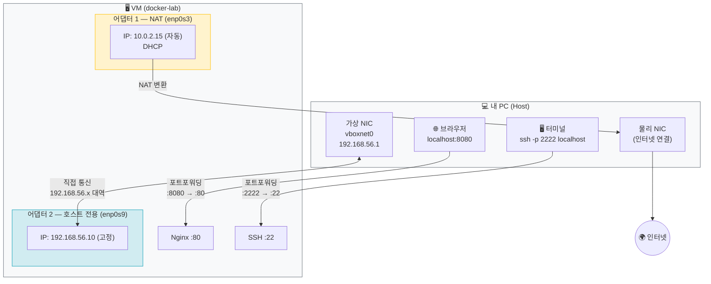

# 1-1. VM 직접 체험 — VirtualBox로 Ubuntu 서버 구축하기

## 실습 목표

이 가이드는 다음을 직접 경험하는 데 목적이 있습니다.

- VirtualBox에 Ubuntu 24.04 VM 설치 및 실행
- VM 부팅 속도가 느리다는 점 체감
- VM 내부에 Nginx 설치 후 포트포워딩으로 로컬 브라우저에서 확인
- Docker 설치 후 Nginx를 한 번에 실행하여 VM 방식과 비교

## 준비물

- Windows/macOS/Linux PC
- 인터넷 연결
- 관리자 권한

## 공식 다운로드 링크

- [VirtualBox 공식 다운로드](https://www.virtualbox.org/wiki/Downloads){target=_blank}
- [Ubuntu Server 24.04 LTS 다운로드](https://ubuntu.com/download/server){target=_blank}
- [Docker Engine (Ubuntu) 설치 문서](https://docs.docker.com/engine/install/ubuntu/){target=_blank}
- [Docker Desktop (Windows/macOS)](https://www.docker.com/products/docker-desktop/){target=_blank}

## 1) VirtualBox 설치

!!! warning "Windows 사용자 — 설치 전 확인"
    Windows에서 **Hyper-V**가 활성화되어 있으면 VirtualBox가 정상적으로 실행되지 않을 수 있습니다.
    설치 전에 PowerShell을 **관리자 권한**으로 열고 현재 상태를 먼저 확인하세요.

    **① 현재 상태 확인**
    ```powershell
    bcdedit /enum | findstr -i hypervisor
    ```

    | 출력값 | 의미 |
    |--------|------|
    | `hypervisorlaunchtype    Auto` | Hyper-V 활성화 상태 → 아래 ②번 실행 필요 |
    | `hypervisorlaunchtype    Off` | 이미 꺼져있음 → 그냥 넘어가세요 |
    | _(아무 출력 없음)_ | Hyper-V 미설치 → 그냥 넘어가세요 |

    **② Hyper-V 비활성화 (①에서 `Auto`로 나온 경우만)**
    ```powershell
    bcdedit /set hypervisorlaunchtype off
    ```

    실행 후 **반드시 재부팅**합니다. (VirtualBox 설치는 재부팅 후 진행하세요.)

1. [VirtualBox 공식 다운로드 페이지](https://www.virtualbox.org/wiki/Downloads){target=_blank}에서 최신 버전을 다운로드합니다.
2. 기본 옵션으로 설치합니다.
3. 설치 완료 후 VirtualBox를 실행합니다.

!!! info "Windows — 설치 중 나타나는 경고 창"
    설치 중 아래 대화상자가 차례로 나타납니다. 모두 **예(Yes)** 또는 **계속(Continue)** 를 클릭하세요.

    | 메시지 | 의미 | 처리 |
    |--------|------|------|
    | "Warning: Network Interfaces" | 가상 네트워크 어댑터 설치로 잠시 인터넷 연결이 끊김 | **예** 클릭 |
    | "Warning: USB Support" | USB 필터 드라이버 설치 | **예** 클릭 |
    | Windows 보안 경고 (방화벽) | VirtualBox 네트워크 허용 요청 | **액세스 허용** 클릭 |

    설치 중 화면이 잠깐 까맣게 되거나 인터넷이 1~2초 끊기는 것은 정상입니다.

## 2) Ubuntu Server 24.04 이미지 준비

!!! warning "반드시 24.04 LTS를 다운로드하세요"
    현재 Ubuntu 공식 사이트 기본 다운로드는 **26**입니다.
    이 실습은 **24.04 LTS** 기준으로 작성되었으므로, 아래 안내에 따라 **Previous releases**에서 24.04를 선택해야 합니다.

1. [Ubuntu 공식 다운로드 페이지](https://ubuntu.com/download/server){target=_blank}에 접속합니다.
2. 페이지를 아래로 스크롤하여 **Previous releases** 섹션에서 `Ubuntu Server 24.04 LTS`를 선택합니다.
3. ISO 파일을 다운로드합니다.
4. 파일명을 확인합니다. 예: `ubuntu-24.04.2-live-server-amd64.iso`

## 3) VM 생성

### 기본 정보 입력

1. VirtualBox에서 `새로 만들기`를 클릭합니다.
2. 아래와 같이 입력합니다.

    | 항목 | 값 |
    |------|-----|
    | 이름 | `docker-lab` |
    | ISO Image | 다운로드한 `ubuntu-24.04.x-live-server-amd64.iso` 선택 |
    | 유형 | Linux |
    | 버전 | Ubuntu (64-bit) |

### Username / Password 설정

!!! info "계정 정보"
    - **Username**: `vboxuser` (기본값 그대로 사용)
    - **Password**: 원하는 비밀번호로 변경 가능합니다. 단, 잊지 않도록 메모해 두세요.

### Specify Virtual Hardware (하드웨어 설정)

4. `Next`를 눌러 **Specify Virtual Hardware** 단계로 이동합니다.
5. 아래와 같이 설정합니다.

    | 항목 | 값 |
    |------|-----|
    | Base Memory | **4096 MB** |
    | Processors | **2** |

    !!! warning "메모리·CPU가 부족하면 설치 중 멈춤 현상이 발생할 수 있습니다."

### 디스크 설정

6. **Create a Virtual Hard Disk Now** 선택 후 디스크 크기를 기본값 **25GB** 그대로 사용합니다.
7. `Next` → `Finish`를 클릭해 VM 생성을 완료합니다.

!!! tip "Windows 사용자 — VM 창 안에서 마우스/키보드 캡처"
    VM 창 안쪽을 클릭하면 마우스와 키보드가 VM에 캡처됩니다.
    내 PC로 돌아오려면 **오른쪽 Ctrl (Right Ctrl)** 키를 누르세요.

    | 상태 | 화면 하단 표시 | 해제 방법 |
    |------|--------------|---------|
    | VM이 마우스·키보드 점유 중 | 🔒 `Right Ctrl to release` | **Right Ctrl** 키 |
    | 해제됨 | 아무 표시 없음 | VM 창 클릭 시 다시 캡처 |

    처음에는 당황할 수 있습니다. 커서가 사라졌다면 Right Ctrl을 누르세요.

## 4) VM 부팅 및 Ubuntu 설치

1. VirtualBox에서 `docker-lab` VM을 선택하고 **시작(Start)** 버튼을 클릭합니다.
2. Ubuntu가 **자동으로 설치**됩니다. **약 10~15분** 소요됩니다.

!!! info "자동 설치 중 — 그냥 기다리세요"
    VirtualBox가 앞서 입력한 계정 정보로 Ubuntu를 자동 설치합니다.
    VM 화면에 아래처럼 텍스트가 흘러가는 것은 정상입니다.

    ```
    [  OK  ] Started GRUB...
    Installing system...
    ```

    설치 중간에 VM이 **한 번 자동 재부팅**됩니다. 화면이 잠깐 까맣게 되는 것도 정상입니다.
    VM 창을 닫거나 강제로 종료하지 마세요.

3. 설치가 완료되면 아래와 같은 로그인 화면이 나타납니다.

    ```
    ubuntu login:
    ```

4. VM 창 안을 클릭해 포커스를 맞춘 뒤 아래 순서로 로그인합니다.

    ```
    ubuntu login: vboxuser      ← 사용자명 입력 후 Enter
    Password:                   ← 비밀번호 입력 후 Enter
    ```

!!! warning "비밀번호 입력 시 화면에 아무것도 표시되지 않는 것이 정상입니다"
    Linux는 보안상 비밀번호 입력 중 커서조차 움직이지 않습니다.
    틀린 것이 아니니 그냥 입력하고 Enter를 누르세요.

5. 로그인에 성공하면 아래와 같은 프롬프트가 나타납니다.

    ```
    vboxuser@ubuntu:~$
    ```

    `$` 기호가 보이면 준비 완료입니다. 이후 명령어는 여기에 입력합니다.

## 5) VM 부팅 속도 체감 포인트

아래를 체크해보세요.

- 전원 ON 후 로그인 화면까지 걸리는 시간
- 로그인 후 데스크톱이 완전히 준비되는 시간
- 브라우저/터미널 첫 실행 반응 속도

이 단계에서 "운영체제 전체를 부팅하는 비용"이 있다는 점을 기억합니다.

## 6) VM 내부에 Nginx 설치

VM 터미널에서 실행합니다.

!!! tip "Windows 사용자 — VirtualBox 콘솔에서 붙여넣기"
    VirtualBox 콘솔에서는 기본적으로 `Ctrl+V`가 작동하지 않습니다.

    **방법 1 — 메뉴에서 클립보드 공유 활성화 후 오른쪽 클릭**

    1. VirtualBox 상단 메뉴 → **장치(Devices)** → **공유 클립보드(Shared Clipboard)** → **양방향(Bidirectional)** 선택
    2. 내 PC에서 명령어를 복사한 뒤 VM 창 안에서 **오른쪽 클릭 → 붙여넣기**

    **방법 2 — 8단계 SSH 연결 후 붙여넣기 (권장)**

    8단계에서 SSH를 설정하면 Windows Terminal에서 `Ctrl+V`로 자유롭게 붙여넣을 수 있습니다.
    지금은 명령어를 직접 타이핑하거나 방법 1을 사용하세요.

```bash
sudo apt update
sudo apt install -y nginx
sudo systemctl enable nginx
sudo systemctl start nginx
sudo systemctl status nginx --no-pager
```

정상 동작 확인:

```bash
curl -I http://localhost
```

`HTTP/1.1 200 OK`가 보이면 정상입니다.

## 7) 포트포워딩 설정 (Host -> VM)

목표: 내 PC 브라우저에서 `http://localhost:8080` 접속 시 VM의 Nginx 페이지 표시

!!! warning "포트포워딩 설정은 VM이 꺼진 상태에서 하는 것이 안전합니다"
    실행 중에도 설정 가능하지만, VM을 먼저 종료하고 진행하면 오류를 방지할 수 있습니다.

    ```bash
    sudo poweroff
    ```

1. VirtualBox에서 `docker-lab` VM을 클릭합니다.
2. 상단 메뉴 `설정` → `네트워크` → `포트 포워딩`을 클릭합니다.
3. 아래 규칙을 추가합니다.

    | 이름 | 프로토콜 | 호스트 포트 | 게스트 포트 |
    |------|---------|-----------|-----------|
    | nginx | TCP | 8080 | 80 |

    !!! info "호스트 포트 vs 게스트 포트"
        - **호스트 포트 (8080)**: 내 PC에서 접속할 포트입니다.
        - **게스트 포트 (80)**: VM 내부에서 Nginx가 실제로 열고 있는 포트입니다.
        - 즉, `내 PC:8080` → `VM:80` 으로 연결되는 구조입니다.

4. 호스트(내 PC) 브라우저에서 `http://localhost:8080` 접속

Nginx Welcome 페이지가 보이면 성공입니다.

## 8) 다음 실습을 위한 SSH 설치

!!! warning "Windows 사용자 — SSH 명령어는 VM 안이 아니라 내 PC에서 실행합니다"
    아래 `ssh` 명령어는 VM 터미널이 아닌, **내 PC의 Windows Terminal 또는 PowerShell을 새로 열어서** 실행합니다.
    두 개의 창을 띄워두세요. VM 콘솔(VirtualBox 창)과 내 PC 터미널(Windows Terminal)은 별개입니다.

!!! info "Windows OpenSSH 클라이언트 확인"
    Windows 10 1809 이상은 SSH 클라이언트가 기본 내장되어 있습니다.
    Windows Terminal 또는 PowerShell에서 아래 명령어로 확인하세요.

    ```powershell
    ssh -V
    ```

    `OpenSSH_9.x...` 같은 버전 정보가 나오면 바로 사용 가능합니다.

    아무 출력이 없거나 오류가 나오면: **설정 → 앱 → 선택적 기능 → 기능 추가 → OpenSSH 클라이언트** 설치 후 재시도하세요.

VM 터미널에서 실행합니다.

```bash
sudo apt install -y openssh-server
sudo systemctl enable ssh
sudo systemctl start ssh
```

포트포워딩에 SSH 규칙을 추가합니다.

| 이름 | 프로토콜 | 호스트 포트 | 게스트 포트 |
|------|---------|-----------|-----------|
| ssh | TCP | 2222 | 22 |

이후 호스트(내 PC) 터미널에서:

```bash
ssh -p 2222 vboxuser@localhost
```

!!! tip
    SSH 접속 후에는 터미널에서 복사·붙여넣기가 자유롭게 됩니다. 이후 실습부터는 SSH로 접속해서 진행하세요.

## 9) VM 네트워크 구조 이해

VirtualBox에서 VM에 어댑터를 **두 개** 붙이는 이유를 먼저 이해하고 넘어갑니다.



### 어댑터 역할 요약

| | 어댑터 1 — NAT | 어댑터 2 — 호스트 전용 |
|---|---|---|
| **목적** | VM → 인터넷 접속 | Host ↔ VM 직접 통신 |
| **IP 방식** | DHCP 자동 (10.0.2.x) | 고정 IP (192.168.56.10) |
| **Host에서 VM 접근** | 포트포워딩 필요 | IP로 바로 접근 가능 |
| **인터넷 연결** | ✅ 가능 | ❌ 불가 |
| **쓰는 이유** | `apt install`, Docker pull 등 | SSH, curl 등 실습 편의 |

!!! info "왜 두 개 다 필요한가?"
    - **NAT만 있으면**: 인터넷은 되지만 Host → VM 접근 시 매번 포트포워딩 규칙을 추가해야 해서 번거롭습니다.
    - **호스트 전용만 있으면**: `apt install` 같은 인터넷 요청이 전혀 안 됩니다.
    - **둘 다 사용**: NAT로 인터넷, 호스트 전용으로 고정 IP 접속 — 실습에 가장 편한 구성입니다.

---

## 10) 호스트 전용 네트워크 설정 (Host-Only)

### VirtualBox 어댑터 추가

!!! warning "VM을 먼저 종료하세요"
    ```bash
    sudo poweroff
    ```

1. `docker-lab` VM 설정 → `네트워크` → **어댑터 2** 탭 클릭
2. **사용하기** 체크
3. 다음에 연결됨: **호스트 전용 어댑터** 선택
4. 확인 후 VM 재시작

### 고정 IP 설정 (Netplan)

SSH로 접속 후 관리자 권한으로 전환합니다.

```bash
sudo su
```

!!! info "sudo su 란?"
    `sudo su` 는 일반 사용자에서 **root(관리자)** 로 전환하는 명령어입니다.

네트워크 인터페이스 목록 확인:

```bash
ip addr
```

Netplan 설정 파일을 열어 확인한 인터페이스를 추가합니다.

```bash
nano /etc/netplan/50-cloud-init.yaml
```

!!! tip "nano 편집기 사용법"
    nano는 터미널 기반 편집기입니다. 마우스 없이 키보드만으로 사용합니다.

    | 동작 | 단축키 |
    |------|--------|
    | 저장 | `Ctrl + O` → Enter |
    | 종료 | `Ctrl + X` |
    | 저장하고 나가기 | `Ctrl + O` → Enter → `Ctrl + X` |
    | 수정 취소 (실행 취소) | `Ctrl + U` |

    **순서 요약**: 편집 완료 → `Ctrl + O` (저장 확인 프롬프트 나타남) → `Enter` (파일명 확정) → `Ctrl + X` (종료)

아래와 같이 작성합니다.

```yaml
network:
  version: 2
  ethernets:
    enp0s3:
      dhcp4: true
    enp0s9:
      dhcp4: no
      addresses:
        - 192.168.56.10/24
```

저장 후 적용합니다.

```bash
sudo netplan apply
ip addr show enp0s9
```

`192.168.56.10`이 보이면 성공입니다.

### 접속 확인

=== "Windows PowerShell"
    ```powershell
    ssh vboxuser@192.168.56.10
    curl.exe http://192.168.56.10
    ```
=== "macOS/Linux"
    ```bash
    ssh vboxuser@192.168.56.10
    curl http://192.168.56.10
    ```

!!! info "이후 실습에서는 `192.168.56.10` 을 VM 주소로 사용합니다."

## 11) Docker 설치

이제 VM 위에 Docker를 설치합니다. VM 터미널(또는 SSH 접속 후)에서 아래 명령어를 순서대로 실행하세요.

### 기존 패키지 제거

```bash
sudo apt remove -y docker docker-engine docker.io containerd runc
```

### 필수 패키지 및 Docker 공식 저장소 등록

```bash
sudo apt update
sudo apt install -y ca-certificates curl gnupg

sudo install -m 0755 -d /etc/apt/keyrings
curl -fsSL https://download.docker.com/linux/ubuntu/gpg \
  | sudo gpg --dearmor -o /etc/apt/keyrings/docker.gpg
sudo chmod a+r /etc/apt/keyrings/docker.gpg

echo \
  "deb [arch=$(dpkg --print-architecture) signed-by=/etc/apt/keyrings/docker.gpg] \
  https://download.docker.com/linux/ubuntu \
  $(. /etc/os-release && echo "$VERSION_CODENAME") stable" \
  | sudo tee /etc/apt/sources.list.d/docker.list > /dev/null
```

### Docker Engine 설치

```bash
sudo apt update
sudo apt install -y docker-ce docker-ce-cli containerd.io docker-buildx-plugin docker-compose-plugin
```

### Docker 서비스 시작 및 자동 실행 등록

```bash
sudo systemctl enable docker
sudo systemctl start docker
sudo systemctl status docker --no-pager
```

### sudo 없이 docker 명령어 사용 (선택)

```bash
sudo usermod -aG docker $USER
newgrp docker
```

### 설치 확인

```bash
docker version
docker run hello-world
```

`Hello from Docker!` 메시지가 출력되면 Docker 설치가 완료된 것입니다.
